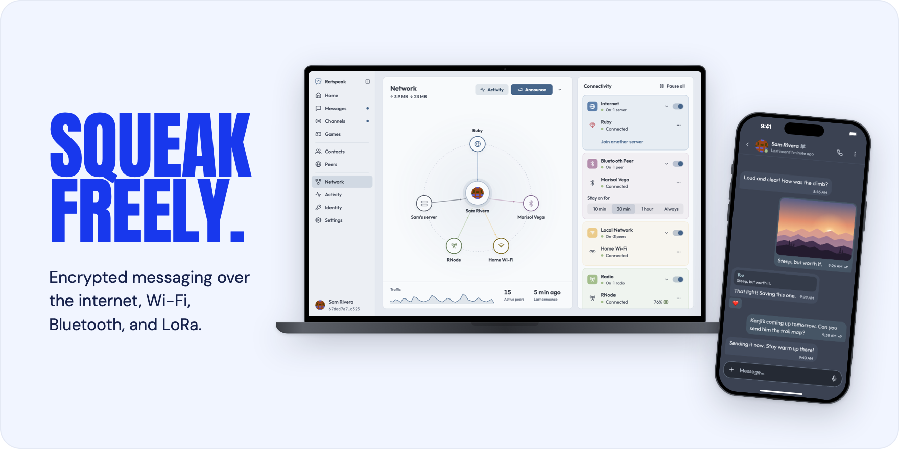

<div align="center">


# Ratspeak

Ratspeak is a native desktop and mobile client for end-to-end encrypted direct conversations over Reticulum. It includes file/image sharing, experimental voice calls and voice messages, shared Channels, LoRa and Bluetooth connections, offline inbox support, and turn-based games.

[Click here for iOS TestFlight Public Beta!](https://testflight.apple.com/join/AzzW4Jg6)

[Docs](https://docs.ratspeak.org/) |
[Build from source](https://docs.ratspeak.org/docs/reference/building-from-source) |
[rsReticulum](https://github.com/ratspeak/rsReticulum) |
[rsLXMF](https://github.com/ratspeak/rsLXMF) |
[rsLXST](https://github.com/ratspeak/rsLXST)


[](LICENSE)
[](https://www.rust-lang.org)
[](#current-state)

<picture>
  <source media="(prefers-color-scheme: dark)" srcset="docs/readme/ratspeak-banner-dark.png">
  
</picture>

</div>

## What It Is

Ratspeak is for private messaging when the normal internet is unavailable,
untrusted, or not the path you want to depend on. When your cell tower is down, when natural disaster hits, or when you just want an alternative. When you know the current system is broken.

It runs on
[rsReticulum](https://github.com/ratspeak/rsReticulum) and [rsLXMF](https://github.com/ratspeak/rsLXMF), Rust ports of
[Reticulum](https://github.com/markqvist/Reticulum) and [LXMF](https://github.com/markqvist/LXMF), so conversations can happen
over regular internet, compatible LoRa radios, WiFi and Bluetooth. The usable paths depend on your configured interfaces, hardware and platform.

There is no Ratspeak account server, no central database, no hub where everything routes through by default. Your Reticulum identity is generated on
your device, and your messaging address is derived from it. No personal information is needed. A fresh profile needs an enabled interface before it can reach peers.

## Current State

Ratspeak is in experimental/alpha status. That means there are bugs, there are quirks, and things are not perfect. If something isn't working up to your standards, or at all, open an issue with the details needed to reproduce it. Useful, direct feedback helps us fix things faster.

Current public packages are available for macOS, Windows, Linux and Android at
[ratspeak.org/download.html](https://ratspeak.org/download.html). The app also has
an [iOS TestFlight beta](https://testflight.apple.com/join/AzzW4Jg6); TestFlight
controls which build is currently offered and whether places are available.
Choose the package matching your operating system and processor, and read its
release notes for changes and platform limitations.

## What You Get

- Account-free messaging over Reticulum.
- Store-and-forward messaging through a configured, reachable propagation node; availability and retention depend on that node.
- Shared Channels with local history, member presence and optional desktop hub
  hosting. Hubs distribute live messages; local history is not a replay backlog.
- Local Network, TCP, RNode/LoRa support, Bluetooth Peering, and more.
- Contacts, discovered peers, path requests, interface status, propagation
  status, and transport health in the app.
- Activity tools for understanding network and messaging events without
  leaving the app.
- Experimental peer-to-peer voice calls over [LXST](https://github.com/ratspeak/rsLXST)
  (native microphone/speaker; incoming callers must be a contact or a recognized direct peer).
- Experimental voice messages with local recording and playback.
- Chess, Tic-Tac-Toe, and Four in a Row.
- Built-in light/dark modes, selectable color themes, and adjustable text size.

## Install

Get the current installers from
[ratspeak.org/download.html](https://ratspeak.org/download.html).

For setup help, see:

- [Install and Platform Setup](https://docs.ratspeak.org/docs/getting-started/install-and-platform-setup)
- [Your First Session](https://docs.ratspeak.org/docs/getting-started/your-first-session)
- [Troubleshooting](https://docs.ratspeak.org/docs/reference/troubleshooting)

## Build From Source

The full build guide is here:
[Building from Source](https://docs.ratspeak.org/docs/reference/building-from-source).
It covers desktop prerequisites, Android APKs, iOS signing, release bundles,
building without voice, and packaging.

After installing the desktop prerequisites and Node.js 22.22.0, use the exact
source helper for the current release:

```bash
git clone --branch v1.1.0 https://github.com/ratspeak/Ratspeak.git Ratspeak-source-tools
node Ratspeak-source-tools/scripts/release/checkout-release-source.mjs \
  --tag v1.1.0 --destination ratspeak-v1.1.0-source
cd ratspeak-v1.1.0-source
node Ratspeak/scripts/release/source-integrity.mjs verify-tags
cd Ratspeak
bash dashboard/build-css.sh
cd src-tauri
cargo tauri dev -- --locked
```

## Platform Notes

- iOS does not support general USB serial. Ratspeak's signed iOS builds support
  Local Network and multicast discovery; users must still grant the normal iOS
  Local Network permission. Notifications require user permission, and
  background execution remains subject to iOS lifecycle limits.
- The current Windows EXE/MSI packages do not provide the Bluetooth Peer
  advertiser/peripheral role. Central-only operation requires the other device
  to advertise; see [Bluetooth interfaces](https://docs.ratspeak.org/docs/networking/bluetooth-interfaces).
- Linux Bluetooth Peer depends on BlueZ GATT server and LE advertising support.
- Voice calls require microphone permission per platform; the prompt is
  triggered the first time you place or answer a call.

## License

Ratspeak is licensed under the [Reticulum License](LICENSE), Copyright (c) 2026
Ratspeak LLC. It is built on rsReticulum and rsLXMF, ports of Mark Qvist's
reference implementations of Reticulum and LXMF that carry his copyright under
the same license, and on rsLXST, a port of LXST used under a separate
non-commercial license from its author, so builds that include voice are
non-commercial. The notices are in [NOTICE](NOTICE) and in the app under
About → Licenses.
